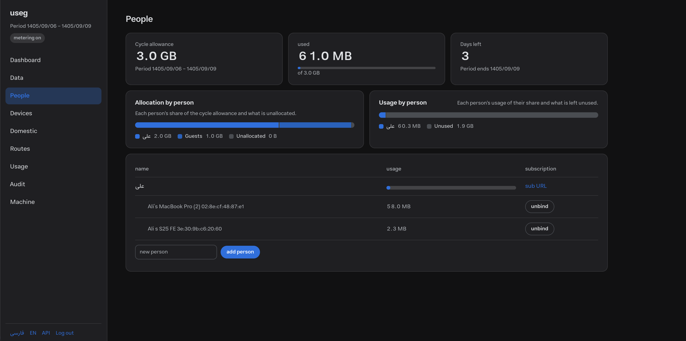

# useg


A home gateway that meters every byte on the LAN, attributes it to a person or a
guest device, and enforces a monthly quota — with no software on the client and
V2Ray subscriptions as both identity and routing contract.

```
client ─▶ nftables prerouting ─TPROXY─▶ sing-box ─▶ outbound ─▶ ISP router
                                              │
                                    Clash API /connections (250 ms)
                                              │
                             usage buckets ─▶ quota ─▶ nft blocked4
```

Three processes on one host: `dnsmasq` (DHCP/DNS), `sing-box` (data plane, pinned
1.14.4, supervised by the agent), and one Go binary `useg` (database, accounting,
quota loop, portal, subscription endpoint, admin UI).




## Features

- **Meters the LAN without touching devices.** nftables TPROXY on a single NIC
  sends TCP through sing-box; the agent polls its Clash API every 250 ms, books
  per-connection deltas, flushes every 5 minutes, and shows the drift between the
  raw nft counters and the ledger. Only traffic that leaves the LAN is booked:
  LAN-to-LAN, mDNS/broadcast and traffic to the box never enter the ledger.
- **Attributes traffic from DHCP.** dnsmasq leases give IP → MAC → device. A
  device becomes a person's when it fetches that person's subscription or opens a
  VLESS connection from its IP; everything else is a guest with its own allowance.
  Devices are named by their mDNS name when they advertise one (`Ali’s MacBook
  Pro`), otherwise by the DHCP hostname, otherwise by MAC.
- **Bills in Jalali months.** Periods come from a fixed anchor day, not from a
  calendar library's idea of a month. Rating is a route × class multiplier, so a
  domestic class can cost less than the default.
- **Enforces quotas.** Weighted or explicit per-person shares, a shared guest pool
  plus a per-device allowance. A cap that is hit blocks the subject in nftables
  and flushes its conntrack entries.
- **Routes and subscriptions.** direct / v2ray / socks / http upstreams, one VLESS
  listener per (person, route), and an https subscription URL per person that
  reports remaining quota and one device row per bound device.
- **Operator UI.** Server-rendered Persian portal for blocked devices and a
  password-protected admin (people, devices, routes, rates, periods, audit log,
  `/admin/api/summary`).
- **Small ops surface.** SQLite in WAL mode, systemd units, a nightly backup
  timer, and a bypass switch that drops the metering table but keeps NAT intact.

## Not in v1

- The psiphon route kind is a label; the outbound is whatever `upstream_json` says.
- No per-route grants: `allow_all=false` hides a route from every subscription.
- No IPv6, no content filtering, no TLS on the proxy LAN hop (the subscription
  link itself is https).
- QUIC is dropped rather than measured — its hostname is invisible to the poll.

## Install

Debian 12 on the gateway is the only supported target: the data plane is
Linux-only (TPROXY, nftables, conntrack), and it expects a single NIC and
control of the LAN's DHCP.

```sh
git clone https://github.com/ali2236/useg /opt/useg
cd /opt/useg
sudo make install
```

The first run asks four things — the box's LAN IP, the router's IP, the LAN
interface, and an admin password — and then does the rest.

<details>
<summary>What <code>make install</code> does</summary>

- installs `nftables`, `dnsmasq`, `sqlite3`, `conntrack`, `curl` and `passwd`
  with apt when missing;
- installs Go from Debian's own apt repo when it is new enough (trixie has 1.24)
  and otherwise downloads 1.23.6 from a mirror, plus the pinned sing-box 1.14.4
  to `/usr/local/bin/sing-box`;
- builds `useg` and installs it, the systemd units, the backup timer and this
  README to `/usr/local/share/useg`;
- writes `/etc/useg/config.yaml` (mode 0640, owner `root:useg`) and derives
  `lan_cidr` as `x.y.z.0/24`;
- generates `/etc/dnsmasq.d/useg.conf` and `/etc/sysctl.d/90-useg.conf` from
  that config, so edit the config and not those two files;
- enables and starts `useg`, `dnsmasq` and the nightly backup timer.

Rerunning `sudo make install` is safe: it prompts nothing, keeps the config and
the database, and restarts the service.

</details>

Downloads are picked to work from Iran: apt uses the box's own Debian mirror, Go
comes from apt on trixie (module downloads go through `goproxy.cn`/Aliyun, since
`proxy.golang.org` and `go.dev` are Google), and sing-box comes from GitHub.
Override them with `GOPROXY=...`, `GO_MIRROR=...` or `SB_URL=...`.

### After install

1. Turn the ISP router's DHCP **off**. This is the one unavoidable step; two
   DHCP servers on one segment is how this class of setup half-works.
2. Point the box's own resolver away from the router (`/etc/resolv.conf`, or
   `resolvectl`): its DNS stops when its DHCP is off. Use `217.218.127.127` or
   the box's own IP.
3. Open `http://<box-ip>:8080/admin`, set the Jalali anchor and the pools
   (Period), then add people. The service creates the two direct routes
   (`primary` and `upstream`) and one listener per person for them on first
   start, so the subscription works before you touch Routes.

If your LAN is not a /24, edit `lan_cidr` in `/etc/useg/config.yaml` and run
`sudo make update`.

Admin is on `:8080` over plain HTTP on purpose: on a family LAN that is
acceptable; reach it through an SSH tunnel if it is not.

## Update

```sh
cd /opt/useg && sudo make update
```

`make update` is `git pull --ff-only` plus `make install`: rebuild, reinstall
the binary, units and generated files, restart `useg` and `dnsmasq`. It never
touches `/etc/useg/config.yaml` or the database. From another machine:

```sh
ssh root@gateway 'cd /opt/useg && make update'
```

Do not edit files inside `/opt/useg` — the pull will refuse and you will have to
stash first. Logs are `journalctl -u useg -f`.

## Day-to-day

| Task | Command |
|---|---|
| Update to the latest commit | `cd /opt/useg && sudo make update` |
| Maintenance bypass (plain routing, nothing counted) | the admin banner switch; it survives restarts |
| Give everyone unlimited internet (still metered) | the admin Household "Disable all caps" switch |
| Back to metered | the same switch |
| Bypass from a shell (UI unreachable) | `nft delete table inet useg` — NAT stays, traffic flows |
| Undo the shell bypass | `systemctl restart useg` (rebuilds the table and the block set) |
| Wipe all usage (keeps people, routes and the pool) | `sudo make reset` |
| Restore a backup | `systemctl stop useg; cp backups/useg-YYYYMMDD-HHMM.db /var/lib/useg/useg.db; systemctl start useg` |
| Escape hatch, whole system | turn the router's DHCP back on |
| Upcoming Jalali boundaries | `useg period -c /etc/useg/config.yaml` |

## Configuration

`deploy/config.example.yaml` is the reference for every key. The installed file
is `/etc/useg/config.yaml`; `make install` regenerates the dnsmasq and sysctl
files from it, so it is the only source of truth.

| Key | Default | Notes |
|---|---|---|
| `lan_cidr`, `box_ip`, `router_ip`, `iface` | `192.168.100.0/24`, `.2`, `.1`, `eth0` | the LAN facts; the install asks for them |
| `portal_listen`, `admin_listen` | `:80`, `:8080` | portal on 80 so blocked HTTP can redirect to it |
| `admin_password` | — | the admin login; change it before first boot |
| `tls_listen` | `:443` | self-signed cert at `data_dir/tls`; import `sub.crt` on the phones, or point `tls_cert`/`tls_key` at a real cert. `off` falls back to http subscription links |
| `enforce` | `true` | `false` runs the agent for its UI/database only, not as a gateway |

## Development

Needs a Linux host with Docker and Compose. The dev rig runs the same Linux
binary and the same paths as the box, on one bridge network: the gateway at `10.66.0.2` is the clients' default route, and
`10.66.0.1` (Docker's own bridge gateway) plays the ISP router.

```sh
make test        # go vet + unit tests, native, no network
make dev         # build the Linux binary + docker compose up
```

Then:

| | |
|---|---|
| portal | http://localhost:8080 — as seen by an unknown device, which is correct |
| admin | http://localhost:8081/admin — password `dev` |
| a real client | `make a-curl` (client-a → box → internet, TPROXY) |
| lane B (VLESS) | point a real V2Ray client at a subscription URL |
| P0 probe | `make probe` while a transfer is open |

A device only shows up once its source IP has a lease; the rig writes two static
leases for the client containers. To bind client-a to the first person:

```sh
TOKEN=$(sqlite3 dev/data/useg.db "select sub_token from person where id=1")
docker compose exec client-a curl -s "http://10.66.0.2:8080/sub/$TOKEN"
docker compose exec client-a curl -s http://10.66.0.2:8080/   # now sees that person
```

Seeded dev numbers are deliberately tiny (50 MB charged pool, 20 MB guest pool,
5 MB per guest device) so quota behaviour shows up in minutes instead of weeks.
`make dev-fresh` wipes the database and reseeds.

The dev network is `10.66.0.0/24`, not a typical home `192.168.100.0/24`, so the
two never fight over routes. Docker Hub is blocked on some networks, so the
Dockerfiles pull base images from `docker.m.daocloud.io`; on a network where Hub
is reachable, drop that prefix.

## Known limits

- **Short flows are under-counted.** Anything that opens and closes between two
  polls is invisible to the ledger. The drift line in the admin (nft counters vs
  ledger, both directions) is the honest measure; it is only meaningful over
  hours, not over one download. Fixing it properly needs flow-close events or
  eBPF — out of scope for poll-based v1.
- **The ledger and the ISP's meter drift** for reasons that have nothing to do
  with bugs: NAT overhead, the router's own traffic, retransmits. Set
  `raw_ceiling` a few percent below the ISP's number.
- **A device that ARP-spoofs the router bypasses the box entirely.** It needs a
  VLAN or a second NIC to close.
- **`allow_all=false` routes are invisible to everyone** in v1; there is no
  per-route grant table yet.
- **Admin is plain HTTP on the LAN.** A LAN attacker can sniff the session
  cookie. Use an SSH tunnel if that matters.

## Privacy

Only metadata is measured: SNI/host, destination, byte counts, timing. No TLS
interception, no content. QUIC is dropped because its hostname is invisible.
Tell the household the gateway exists — an operator who does not is lying to the
people whose traffic they meter.

## Specs

The design and its rationale live in [specs/](specs/README.md): packet path,
addressing, identity, accounting, periods, quotas, data model, operations.

## License

MIT — see [LICENSE](LICENSE).
