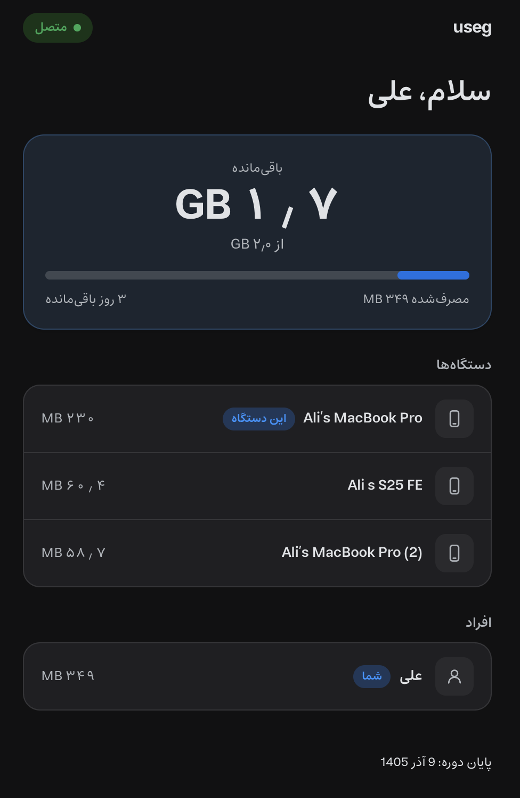

# useg


A home gateway that meters every byte on the LAN, attributes it to a person or a
guest device, and enforces a monthly quota — with no software on the client and
V2Ray subscriptions as both identity and routing contract.

```
client ─▶ nftables prerouting ─TPROXY─▶ sing-box ─▶ outbound ─▶ ISP router
                                              │
                                    Clash API /connections (250 ms)
                                              │
                             usage buckets ─▶ quota ─▶ nft blocked4
```

Three processes on one host: `dnsmasq` (DHCP/DNS), `sing-box` (data plane, pinned
1.14.4, supervised by the agent), and one Go binary `useg` (database, accounting,
quota loop, portal, subscription endpoint, admin UI).

<p align="center"></p>

<p align="center"></p>

## Features

- **Meters the LAN without touching devices.** nftables TPROXY on one NIC sends
  TCP through sing-box; the agent polls its Clash API every 250 ms and books
  per-connection deltas. Only traffic that leaves the LAN is counted, and the
  admin shows the drift between the raw nft counters and the ledger.
- **Attributes traffic from DHCP.** Leases give IP → MAC → device. A device
  becomes a person's when it fetches their subscription or opens a VLESS
  connection from its IP; everything else is a guest with its own allowance.
  Devices take their mDNS name, then the DHCP hostname, then their MAC.
- **Bills in Jalali months.** Periods come from a fixed anchor day, not from a
  calendar library's idea of a month. Rating is a route × class multiplier, so a
  domestic class can cost less than the default.
- **Enforces quotas.** Weighted or explicit per-person shares, a shared guest pool
  and a per-device allowance. A cap that is hit blocks the subject in nftables
  and flushes its conntrack entries.
- **Routes, subscriptions and UI.** direct / v2ray / socks / http upstreams, one
  VLESS listener per (person, route), an https subscription URL that reports
  remaining quota and one row per bound device, a Persian portal for blocked
  devices, and a password-protected admin for the rest.

## Install

Debian 12 on the gateway is the only supported target: the data plane is
Linux-only (TPROXY, nftables, conntrack), and it expects a single NIC and
control of the LAN's DHCP.

```sh
git clone https://github.com/ali2236/useg /opt/useg
cd /opt/useg
sudo make install
```

The first run asks four things — the box's LAN IP, the router's IP, the LAN
interface, and an admin password — and then does the rest.

<details>
<summary>What <code>make install</code> does</summary>

- installs `nftables`, `dnsmasq`, `sqlite3`, `conntrack`, `curl` and `passwd`
  with apt when missing;
- installs Go from Debian's apt repo when it is new enough (trixie has 1.24) and
  otherwise downloads 1.23.6 from a mirror, plus the pinned sing-box 1.14.4 to
  `/usr/local/bin/sing-box`;
- builds `useg` and installs it, the systemd units, the backup timer and this
  README to `/usr/local/share/useg`;
- writes `/etc/useg/config.yaml` (mode 0640, owner `root:useg`) and derives
  `lan_cidr` as `x.y.z.0/24`;
- generates `/etc/dnsmasq.d/useg.conf` and `/etc/sysctl.d/90-useg.conf` from
  that config, so edit the config and not those two files;
- enables and starts `useg`, `dnsmasq` and the nightly backup timer.

Rerunning `sudo make install` is safe: it prompts nothing, keeps the config and
the database, and restarts the service.

</details>

Downloads are picked to work from Iran: apt uses the box's own mirror, Go comes
from apt on trixie (modules go through `goproxy.cn`/Aliyun, since
`proxy.golang.org` is Google), and sing-box comes from GitHub. Override them
with `GOPROXY=...`, `GO_MIRROR=...` or `SB_URL=...`.

### After install

1. Turn the ISP router's DHCP **off**. This is the one unavoidable step; two
   DHCP servers on one segment is how this class of setup half-works.
2. Point the box's own resolver away from the router (`/etc/resolv.conf`, or
   `resolvectl`): its DNS stops when its DHCP is off. Use `217.218.127.127` or
   the box's own IP.
3. Open `http://<box-ip>:8080/admin`, set the Jalali anchor and the pools
   (Period), then add people. The service creates the two direct routes
   (`primary` and `upstream`) and one listener per person on first start, so the
   subscription works before you touch Routes.

Subscription links are https with a self-signed cert written to
`/var/lib/useg/tls`; import its `sub.crt` on the phones, or set `tls_cert` and
`tls_key` to a real one (`tls_listen: "off"` falls back to http links). Admin is
plain HTTP on the LAN on purpose — use an SSH tunnel if that bothers you.

If your LAN is not a /24, edit `lan_cidr` in `/etc/useg/config.yaml` and run
`sudo make update`.

## Update

```sh
cd /opt/useg && sudo make update
```

`make update` is `git pull --ff-only` plus `make install`: rebuild, reinstall,
restart. It never touches `/etc/useg/config.yaml` or the database. From another
machine:

```sh
ssh root@gateway 'cd /opt/useg && make update'
```

Do not edit files inside `/opt/useg` — the pull will refuse and you will have to
stash first. Logs are `journalctl -u useg -f`.

## Day-to-day

| Task | Command |
|---|---|
| Update to the latest commit | `cd /opt/useg && sudo make update` |
| Maintenance bypass (plain routing, nothing counted) | the admin banner switch; survives restarts |
| Give everyone unlimited internet (still metered) | the admin Household "Disable all caps" switch; the same switch turns it back |
| Bypass from a shell (UI unreachable) | `nft delete table inet useg` — NAT stays; `systemctl restart useg` undoes it |
| Wipe all usage (keeps people, routes and the pool) | `sudo make reset` |
| Restore a backup | `systemctl stop useg; cp backups/useg-YYYYMMDD-HHMM.db /var/lib/useg/useg.db; systemctl start useg` |
| Upcoming Jalali boundaries | `useg period -c /etc/useg/config.yaml` |

Whole-system escape hatch: turn the router's DHCP back on and the box is out of
the path.

## Development

Needs a Linux host with Docker and Compose. The dev rig runs the same Linux
binary and the same paths as the box, on one bridge network: the gateway at
`10.66.0.2` is the clients' default route, and `10.66.0.1` (Docker's own bridge
gateway) plays the ISP router.

```sh
make test        # go vet + unit tests, native, no network
make dev         # build the Linux binary + docker compose up
```

Then:

| | |
|---|---|
| portal | http://localhost:8080 — as seen by an unknown device, which is correct |
| admin | http://localhost:8081/admin — password `dev` |
| a real client | `make a-curl` (client-a → box → internet, TPROXY) |
| lane B (VLESS) | point a real V2Ray client at a subscription URL |
| P0 probe | `make probe` while a transfer is open |

A device only shows up once its source IP has a lease; the rig writes two static
leases for the client containers. To bind client-a to the first person:

```sh
TOKEN=$(sqlite3 dev/data/useg.db "select sub_token from person where id=1")
docker compose exec client-a curl -s "http://10.66.0.2:8080/sub/$TOKEN"
docker compose exec client-a curl -s http://10.66.0.2:8080/   # now sees that person
```

Seeded dev numbers are deliberately tiny (50 MB charged pool, 20 MB guest pool,
5 MB per guest device) so quota behaviour shows up in minutes instead of weeks.
`make dev-fresh` wipes the database and reseeds. The dev network is
`10.66.0.0/24` so it never fights with a home `192.168.100.0/24`, and the
Dockerfiles pull base images from `docker.m.daocloud.io` because Docker Hub is
blocked on some networks; drop the prefix where Hub is reachable.

## Known limits

- **Short flows are under-counted.** Anything that opens and closes between two
  polls is invisible to the ledger. The admin's drift line (nft counters vs
  ledger) is the honest measure; it is only meaningful over hours, not over one
  download. Fixing it properly needs flow-close events or eBPF — out of scope
  for poll-based v1.
- **The ledger and the ISP's meter drift** for reasons that have nothing to do
  with bugs: NAT overhead, the router's own traffic, retransmits. Set
  `raw_ceiling` a few percent below the ISP's number.
- **A device that ARP-spoofs the router bypasses the box entirely.** It needs a
  VLAN or a second NIC to close.
- **`allow_all=false` routes are invisible to everyone** in v1; there is no
  per-route grant table yet.
- **Admin is plain HTTP on the LAN.** A LAN attacker can sniff the session
  cookie. Use an SSH tunnel if that matters.
- **No IPv6 and no content filtering.** QUIC is dropped rather than measured,
  and the psiphon route kind is only a label.

## Privacy

Only metadata is measured: SNI/host, destination, byte counts, timing. No TLS
interception, no content. Tell the household the gateway exists — an operator
who does not is lying to the people whose traffic they meter.

## Specs

The design and its rationale live in [specs/](specs/README.md): packet path,
addressing, identity, accounting, periods, quotas, data model, operations.

## License

MIT — see [LICENSE](LICENSE).
